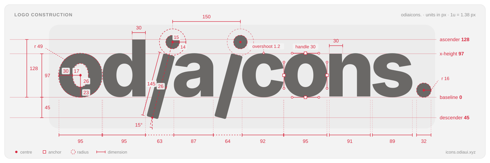

<p align="center">
  
</p>

# OdiaIcons

<p align="center">
  <strong>Free, open-source icons inspired by Odisha’s temples, textiles, and living traditions.</strong>
</p>

<p align="center">
  <a href="https://icons.odiaui.xyz">Website</a> ·
  <a href="https://icons.odiaui.xyz/icons">Browse Icons</a> ·
  <a href="https://github.com/rudranboitei/odia-icons/issues/new">Request an Icon</a> ·
  <a href="#contributing">Contribute</a>
</p>

<p align="center">
  <a href="./LICENSE"></a>
<!-- icon-count-badge:start -->
  
<!-- icon-count-badge:end -->
  
  
  <a href="https://github.com/rudranboitei/odia-icons/pulls"></a>
</p>

---

OdiaIcons is a compact, carefully crafted icon set. The current release is a focused 72-icon set, drawn with Odisha in mind; the Odia motif set is being redrawn in the same style. Every icon is drawn on a shared 24 × 24 grid, uses `currentColor`, and is designed to feel consistent across product interfaces, websites, and editorial layouts.

Search and discover icons in **English** or **ଓଡ଼ିଆ** on the [icon browser](https://icons.odiaui.xyz/icons).

## Highlights

- **Rooted in Odisha** — Designed in Odisha. The first release is a starter set, with Odia motifs returning in the same style.
- **Consistent by design** — Every icon follows a 24 × 24 grid, 2px safe padding, 2px stroke, round caps, and round joins.
- **Theme-friendly** — Built with `currentColor`, so icons inherit text color and work naturally in light/dark themes.
- **Developer-ready exports** — Copy SVG, JSX, React/TSX, import snippet, or data URI from the playground.
- **Bilingual discovery** — Icon names, tags, and aliases support English and Odia script.
- **Open source** — MIT licensed, free for personal and commercial use.

<!-- icon-set:start -->
## Icon Set

**72 icons and counting:** a focused set. Browse the full set at [icons.odiaui.xyz/icons](https://icons.odiaui.xyz/icons).

| Icon | Name | Odia | Category |
|------|------|------|----------|
| Arrow Left | `arrow-left` | ବାମ ତୀର | UI |
| Arrow Right | `arrow-right` | ତୀର | UI |
| Arrow Up | `arrow-up` | ଉପର ତୀର | UI |
| Bag | `bag` | ଝୋଲା | UI |
| Bell | `bell` | ଘଣ୍ଟି | UI |
| Bolt | `bolt` | ବିଜୁଳି | Nature |
| Book | `book` | ବହି | UI |
| Bookmark | `bookmark` | ବୁକମାର୍କ | UI |
| Briefcase | `briefcase` | ବ୍ରିଫକେସ୍ | UI |
| Calendar | `calendar` | କ୍ୟାଲେଣ୍ଡର | UI |
| Camera | `camera` | କ୍ୟାମେରା | UI |
| Card | `card` | କାର୍ଡ | UI |
| Cart | `cart` | ଟୋକେଇ | UI |
| Check | `check` | ଠିକ୍ | UI |
| Chevron Down | `chevron-down` | ତଳକୁ | UI |
| Chevron Left | `chevron-left` | ବାମକୁ | UI |
| Chevron Right | `chevron-right` | ଡାହାଣକୁ | UI |
| Chevron Up | `chevron-up` | ଉପରକୁ | UI |
| Clock | `clock` | ଘଡ଼ି | UI |
| Close | `close` | ବନ୍ଦ | UI |
| Cloud | `cloud` | ମେଘ | Nature |
| Copy | `copy` | ନକଲ | UI |
| Download | `download` | ଡାଉନଲୋଡ୍ | UI |
| Edit | `edit` | ସମ୍ପାଦନ | UI |
| External Link | `external-link` | ବାହାର ଲିଙ୍କ | UI |
| Eye | `eye` | ଆଖି | UI |
| File | `file` | ଫାଇଲ୍ | UI |
| Filter | `filter` | ଫିଲ୍ଟର | UI |
| Flag | `flag` | ପତାକା | UI |
| Folder | `folder` | ଫୋଲ୍ଡର୍ | UI |
| Gift | `gift` | ଉପହାର | UI |
| Globe | `globe` | ଦୁନିଆ | UI |
| Heart | `heart` | ହୃଦୟ | UI |
| Help | `help` | ସାହାଯ୍ୟ | UI |
| Home | `home` | ଘର | UI |
| Image | `image` | ଛବି | UI |
| Info | `info` | ସୂଚନା | UI |
| Leaf | `leaf` | ପତ୍ର | Nature |
| Lifebuoy | `lifebuoy` | ସହାୟତା | UI |
| Link | `link` | ଲିଙ୍କ୍ | UI |
| Lock | `lock` | ତାଲା | UI |
| Logout | `logout` | ଲଗଆଉଟ୍ | UI |
| Mail | `mail` | ଚିଠି | UI |
| Map Pin | `map-pin` | ସ୍ଥାନ | UI |
| Menu | `menu` | ମେନୁ | UI |
| Message | `message` | ବାର୍ତ୍ତା | UI |
| Mic | `mic` | ମାଇକ୍ | UI |
| Moon | `moon` | ଚନ୍ଦ୍ର | Nature |
| Music | `music` | ସଙ୍ଗୀତ | UI |
| Note | `note` | ଟିପ୍ପଣୀ | UI |
| Pause | `pause` | ବିରତି | UI |
| Phone | `phone` | ଫୋନ୍ | UI |
| Play | `play` | ଚଲାନ୍ତୁ | UI |
| Plus | `plus` | ଯୋଗ | UI |
| Refresh | `refresh` | ସତେଜ | UI |
| Search | `search` | ଖୋଜ | UI |
| Settings | `settings` | ସେଟିଂ | UI |
| Share | `share` | ବାଣ୍ଟ | UI |
| Sliders | `sliders` | ନିୟନ୍ତ୍ରଣ | UI |
| Smile | `smile` | ହସ | UI |
| Sparkles | `sparkles` | ଚମକ | UI |
| Square Minus | `square-minus` | ବିୟୋଗ | UI |
| Star | `star` | ତାରା | UI |
| Sun | `sun` | ସୂର୍ଯ୍ୟ | Nature |
| Tag | `tag` | ଟ୍ୟାଗ୍ | UI |
| Trash | `trash` | ଅଳିଆ | UI |
| Undo | `undo` | ପଛକୁ | UI |
| Upload | `upload` | ଅପଲୋଡ୍ | UI |
| User | `user` | ବ୍ୟବହାରକାରୀ | UI |
| Volume | `volume` | ଧ୍ୱନି | UI |
| Wallet | `wallet` | ପର୍ସ | UI |
| Wifi | `wifi` | ୱାଇଫାଇ | UI |

> Have a motif in mind? [Request an icon](https://github.com/rudranboitei/odia-icons/issues/new).
<!-- icon-set:end -->

## Getting Started

### Prerequisites

- [Bun](https://bun.sh/) (recommended, project uses `bun@1.4.4`)
- Node.js 20+ for compatibility with the Next.js toolchain

### Local Development

```bash
# Clone the repository
git clone https://github.com/rudranboitei/odia-icons.git
cd odia-icons

# Install dependencies
bun install

# Start the development server
bun dev
```

Open [http://localhost:3000](http://localhost:3000) to view the site.

## Available Scripts

| Command | Description |
|---------|-------------|
| `bun dev` | Starts the Next.js development server. |
| `bun run build` | Runs the icon build pipeline, then creates a production Next.js build. |
| `bun run start` | Starts the production server. |
| `bun run lint` | Runs ESLint across the project. |
| `bun run icons:validate` | Validates icon SVGs and metadata against the OdiaIcons rules. |
| `bun run icons:build` | Regenerates manifests, raw SVGs, sprite, and registry artifacts. |

## Using the Icons

The website includes an interactive icon browser at `/icons` where you can:

- Search by English name, Odia script, tag, alias, or category.
- Preview icons in the playground.
- Adjust size and stroke.
- Copy as **SVG**, **JSX**, **React TSX**, **import snippet**, or **data URI**.
- Download the icon as an **SVG** file.

### Generated Artifacts

The icon pipeline generates the files consumed by the site and tooling:

| Path | Purpose |
|------|---------|
| `src/lib/icons.generated.ts` | Typed icon manifest used by the app. |
| `public/icons.json` | Public manifest for search and tooling. |
| `public/svg/<variant>/*.svg` | Raw, CDN-friendly SVG files. |
| `public/odiaicons-sprite.svg` | SVG sprite with `<symbol>` definitions. |
| `public/r/<name>.json` | shadcn-style registry item for each icon. |

## Icon Design Spec

All icons follow the same visual contract to keep the set cohesive:

| Rule | Value |
|------|-------|
| Canvas | 24 × 24 |
| Safe area | 20 × 20 (2px padding) |
| Style | Outline |
| Stroke width | 2px |
| Stroke caps / joins | Round |
| Color | `currentColor` |
| Fills | None on root |
| Formats | Clean SVG paths/shapes, no hard-coded colors, gradients, filters, masks, or clip-paths |
| Size budget | Max 2KB per icon source |

For the full authoring workflow, see [`SKILL.md`](./SKILL.md).

## Contributing

Contributions are welcome — new icons, metadata improvements, bug fixes, and documentation updates all help.

### Add a New Icon

1. **Create the source SVG** at `icons/outline/<name>.svg`.
2. **Add metadata** at `meta/<name>.json`.
3. **Validate** the icon against the design rules.
4. **Build** generated artifacts.
5. **Open a pull request** with the source, metadata, and a short visual/context note.

#### Metadata Shape

```json
{
  "name": "home",
  "odia": "ଘର",
  "category": "ui",
  "tags": ["home", "house", "main", "start", "ଘର"],
  "aliases": ["house"],
  "variants": ["outline"],
  "contributors": ["your-github-handle"],
  "since": "0.1.0",
  "note": ""
}
```

#### Validate and Build

```bash
bun run icons:validate
bun run icons:build
```

`bun run build` also runs the icon build before the Next.js production build, so the site does not ship stale generated artifacts.

### Contribution Guidelines

- Keep icon names in **kebab-case**.
- Include a meaningful **Odia name** and relevant bilingual tags/aliases.
- Preserve the shared grid, stroke, and visual balance.
- For culturally sensitive or religious symbols, add a brief `note` in metadata.
- Follow the detailed workflow in [`SKILL.md`](./SKILL.md) before submitting.

## Project Structure

```text
.
├── icons/                  # Source icon SVGs by variant
│   └── outline/
├── meta/                   # Icon metadata JSON files
├── public/                 # Static assets and generated icon artifacts
│   ├── svg/
│   ├── r/
│   └── odiaicons-sprite.svg
├── scripts/
│   └── icons/              # Icon validation and build pipeline
├── src/
│   ├── app/                # Next.js App Router pages/layout
│   ├── components/         # UI and marketing components
│   ├── data/               # Site copy and configuration
│   └── lib/                # Icon helpers and generated manifest
├── DESIGN.md               # Design system reference
├── SKILL.md                # Icon authoring workflow
└── package.json
```

## Tech Stack

- **Framework:** [Next.js 16](https://nextjs.org/) (App Router)
- **UI:** [React 19](https://react.dev/)
- **Styling:** [Tailwind CSS 4](https://tailwindcss.com/)
- **Motion:** [Motion](https://motion.dev/)
- **Components:** [shadcn/ui](https://ui.shadcn.com/) + [Base UI](https://base-ui.com/)
- **Code Highlighting:** [Shiki](https://shiki.style/)
- **Package Manager:** [Bun](https://bun.sh/)

## Editing Site Content

Most landing page copy, links, and site configuration live in [`src/data/site.ts`](./src/data/site.ts). Icon rendering and export helpers live in [`src/lib/icons.tsx`](./src/lib/icons.tsx).

## License

Released under the [MIT License](./LICENSE). Free to use in personal and commercial projects.