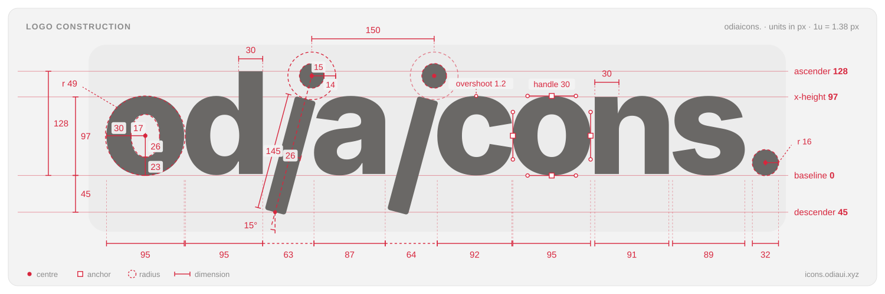

<p align="center">
  
</p>

# @odiaui/icons-react

Free, open-source Odisha icons as typed React components. Every icon is drawn
on a **24 × 24 grid**, uses `currentColor`, and ships as a tree-shakeable named
export. MIT licensed.

- 88 icons: 41 Odisha-inspired icons plus 47 general-purpose UI icons
- React 18+
- TypeScript types included
- ESM and CJS builds
- No runtime dependencies beyond React

## Install

```bash
npm install @odiaui/icons-react
```

```bash
pnpm add @odiaui/icons-react
```

```bash
yarn add @odiaui/icons-react
```

```bash
bun add @odiaui/icons-react
```

## Usage

```tsx
import { Deepa } from "@odiaui/icons-react";

export function Example() {
  return <Deepa size={32} className="text-orange-600" />;
}
```

Colour comes from `currentColor`, so Tailwind text utilities, CSS `color`, or a
`color` prop all work:

```tsx
<Deepa size={24} color="#ea580c" />
```

Every component forwards its ref to the underlying `<svg>`:

```tsx
import { useRef } from "react";
import { Lotus } from "@odiaui/icons-react";

const ref = useRef<SVGSVGElement>(null);
<Lotus ref={ref} size={40} aria-label="Lotus" />;
```

## Props

| Prop          | Type                                   | Default                  | Description                                                        |
| ------------- | -------------------------------------- | ------------------------ | ------------------------------------------------------------------ |
| `size`        | `number \| string`                     | `24`                     | Width and height of the icon.                                      |
| `className`   | `string`                               | —                        | CSS classes applied to the `<svg>`.                                |
| `color`       | `string`                               | `currentColor` inherited | Sets the icon colour. The icon strokes use `currentColor`.          |
| `strokeWidth` | `number \| string`                     | `1.5`                    | Stroke width.                                                      |
| `...props`    | `React.SVGProps<SVGSVGElement>`        | —                        | Any valid SVG attribute, event handler or accessibility prop.      |

Component names are the PascalCase form of the SVG filename. For example,
`olive-ridley-turtle.svg` becomes `OliveRidleyTurtle`:

```tsx
import { OliveRidleyTurtle } from "@odiaui/icons-react";
```

Browse the full set at [icons.odiaui.xyz/icons](https://icons.odiaui.xyz/icons).

> All icons are currently marked `needs-review` in the source metadata. Please review these with native Odia speakers and relevant cultural practitioners before treating them as authoritative.

## Tree-shaking

The package is ESM-first, declares `"sideEffects": false`, and exposes one named
component per icon. Bundlers can remove any icon you do not import.

## Requirements

- React 18 or newer
- Node 18 or newer when building from source

## Licence

MIT © odiaicons contributors. See [LICENSE](./LICENSE).
